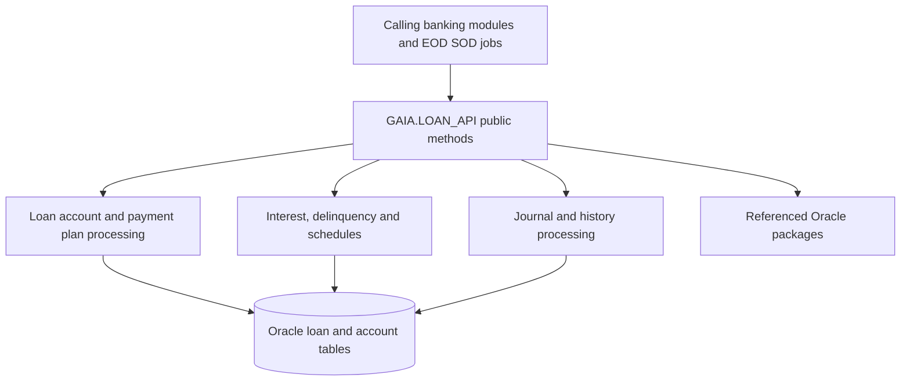

# Architecture

This is a **conceptual grouping of verified public capabilities**, not a complete runtime call graph. See [dependency index](reference/dependencies.md) and [API reference](api/loan-api.md) for directly observed references. Private routines are implementation details and may be invoked by public methods. No cross-package implementation was supplied.
