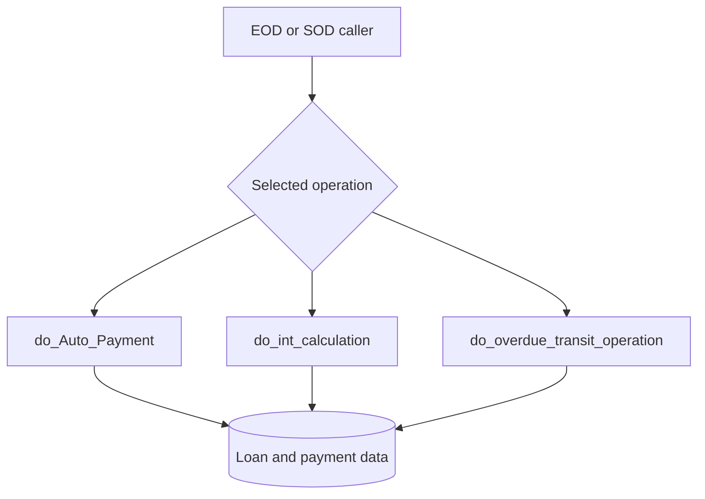

# Banking workflows

## Automated servicing (EOD/SOD)

The specification explicitly documents `do_Auto_Payment`, `do_int_calculation`, and `do_overdue_transit_operation` as EOD/SOD servicing entry points. The sequence among them is **not determined** by the package specification alone; scheduling and operational orchestration require job configuration.

## Core workflows

- **Account creation and journals:** `create_account`, `get_new_acc`, `do_journal_entry`, `create_journal_entries`.
- **Payment planning:** `create_schedule`, `get_standart_schedule`, `get_annuity_schedule`, and plan modification routines.
- **History and reversal:** `create_loan_history`, `update_loan_history`, `reverse_update`, `do_delete_operation`.
- **Limits:** `evaluate_limit_amount` reconciles calculated versus current limit amounts and constructs journal entries (verified in source).

For precise branch conditions, database effects and uncertainty classifications, consult the [method reference](api/loan-api.md).
